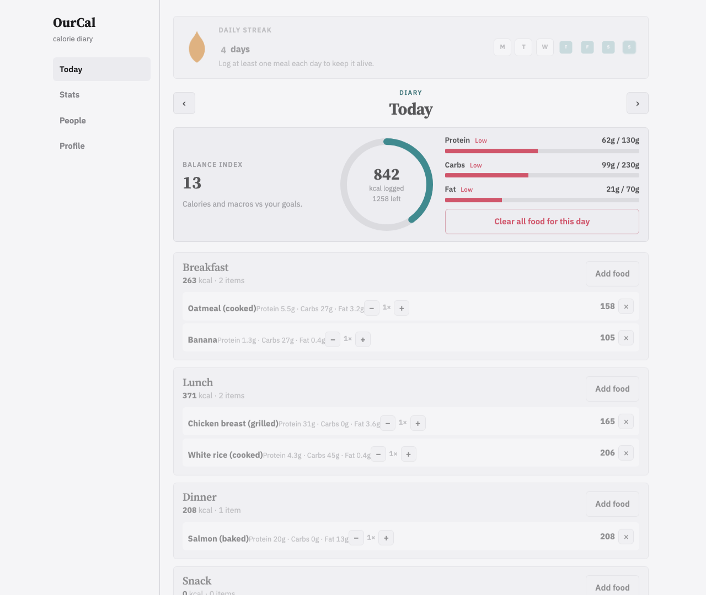
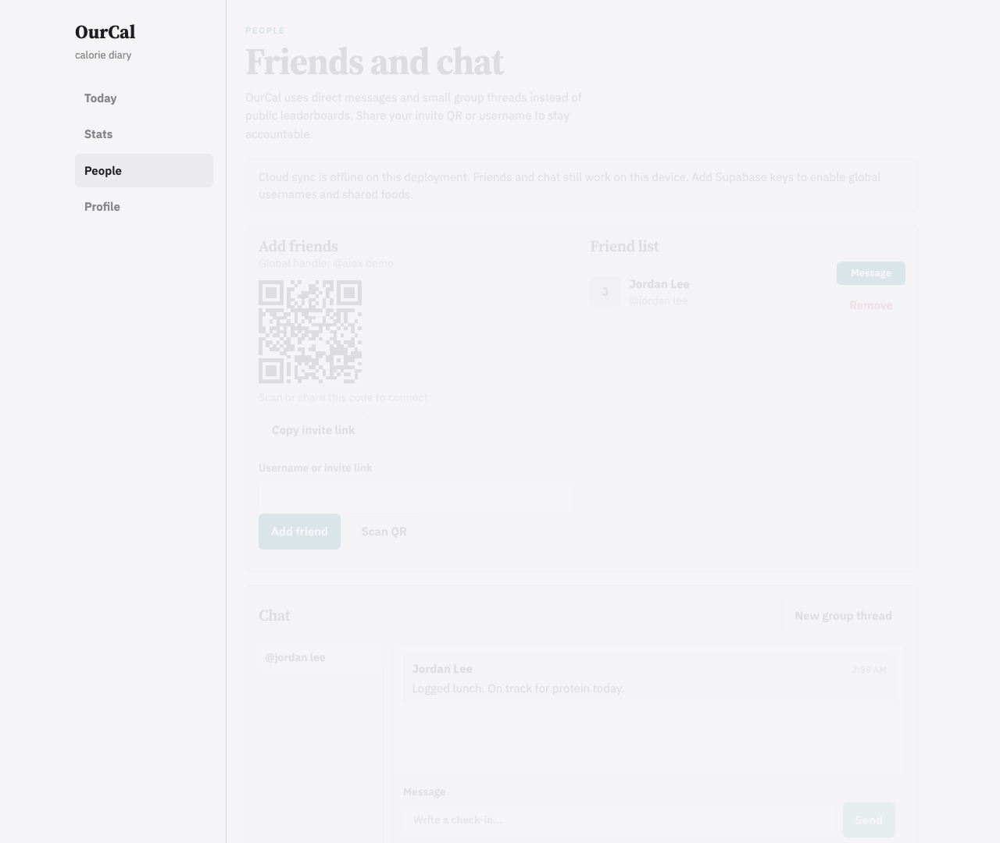

# OurCal

Local-first calorie and macro diary for the browser. It installs on phones, works offline, and has optional Supabase sync for friends and chat.

**Live:** [https://ourcal-pi.vercel.app](https://ourcal-pi.vercel.app)

[](https://github.com/5781mahmood/OurCal/actions/workflows/e2e.yml)

Screenshots use a fictional profile seeded in the browser (`scripts/capture-screenshots.mjs`). They are not a real account.






## Features

- Onboarding estimates a daily calorie target (Mifflin-St Jeor) and protein, carb, and fat goals
- Diary for Breakfast, Lunch, Dinner, and Snack, with search, custom foods, and a servings stepper
- Barcode lookup (type the number or scan it with the camera) through the Open Food Facts API; if a product is missing or the API fails, the barcode moves to a custom food
- Recent foods: the last 8 distinct foods you logged, one tap to log again with the same servings
- Installable on phones (PWA); the app shell is cached so the diary opens offline
- Calorie ring, balance index, and macro levels (Low, On track, High, Over)
- Streak and badges
- Stats for the last 7 days, today vs goal, and today by meal, including empty states
- Friends via username, invite link (`/app?u=`), or QR, plus direct and small group chat
- Profile editing, photo, JSON export and import
- Diary stays in `localStorage` when cloud keys are absent
- Optional email magic-link sign-in. Postgres row-level security keeps each diary, profile, friend list and DM private to its owner ([security model](docs/security.md))

## Tech stack

- React 19, TypeScript, Vite
- React Router
- Supabase (optional Auth, Postgres with row-level security, Realtime)
- Recharts
- qrcode.react and html5-qrcode (friend QR codes and barcode scanning)
- vite-plugin-pwa (manifest and service worker)
- Open Food Facts API
- Vitest and Playwright
- Vercel (deploys from `main`)

## Testing

Vitest covers nutrition, balance index, macro levels, streak, badges, usernames, invite links, recent foods, and the Open Food Facts lookup (barcode validation, per-serving and per-100 g mapping, not found, errors, timeout). Playwright drives Chromium against the Vite app (`playwright.config.ts` starts the dev server), and also runs the database security tests against real Postgres.

| Area | What the specs check |
|------|----------------|
| Onboarding | Calorie goal appears; username suggested from the display name; name required; Start tracking opens Today; Protein / Carbs / Fat labels |
| Diary | Logging updates the ring; Recent list restores the last servings; delete clears it; servings stepper; day navigation and Jump to today; clear-day confirm and cancel; empty search; custom food; no cloud errors in local-first mode |
| Row-level security | Runs `supabase/*.sql` in real Postgres ([PGlite](https://pglite.dev)): signed-out visitors read no private rows; a signed-in user sees only their own diary and cannot write to anyone else's; profile, DM, friend list and shared-food rules |
| Barcode | Per-serving product logs with servings and shows the source; per-100 g product asks for grams; unknown barcode and API failure fall back to Custom; invalid barcode sends no request. Every Open Food Facts request is mocked |
| Install | Manifest is served and valid; app icons load |
| Routing | Landing call to action; custom 404; invite `?u=` opens People |
| People | QR and copy invite (`/app?u=`); no group with zero friends; cannot add yourself; chat Send stays disabled until there is text |
| Stats / Profile | Empty week copy; chart after a log; macro columns; no sign-in without keys; Cancel edit; JSON download |
| Persistence | Reload keeps the diary; export, wipe, and import restores meals |
| Macros / balance | Level words; protein line after chicken; meal kcal header |
| Accessibility smoke | Nav by role; Escape closes the add-food dialog; ring `aria-label` |
| Edge cases | Username too long, with spaces, or too short; invalid friend input; Log food disabled until a food is selected; next day; reset |

```bash
npm test
npm run test:e2e
```

Latest local run: Vitest **31 passed** (8 files). Playwright **60 passed, 2 skipped**. The 2 skipped tests are `e2e/auth-live.spec.ts`, which only run against a real Supabase test project ([how to run them](docs/security.md#running-the-live-tests)).

Headed and UI modes: `npm run test:e2e:headed`, `npm run test:e2e:ui`.

GitHub Actions (`.github/workflows/e2e.yml`) runs the unit tests and Playwright on every push and pull request to `main`.

## Architecture

| Path | Purpose |
|------|---------|
| `src/types.ts` | Domain models |
| `src/lib/nutrition.ts` | BMR, TDEE, macro goals |
| `src/lib/balanceIndex.ts` | Balance score |
| `src/lib/macroLevel.ts` | Macro level, including over goal |
| `src/lib/streak.ts` | Logging streak |
| `src/lib/badges.ts` | Achievements |
| `src/lib/cloud.ts` | Supabase client and sync |
| `src/lib/storage.ts` | localStorage, export, import |
| `src/lib/invite.ts` | Invite URL `/app?u=` |
| `src/lib/openFoodFacts.ts` | Barcode lookup and nutrient mapping |
| `src/lib/recentFoods.ts` | Recent foods from the diary |
| `src/hooks/useTracker.ts` | App state |
| `src/components/*` | Today, Stats, People, Profile, onboarding |
| `src/pages/*` | Landing and 404 |
| `src/data/` | Bundled food catalog |
| `e2e/` | Playwright specs and helpers |
| `supabase/*.sql` | Postgres tables, realtime; `auth_rls.sql` holds every access policy |
| `docs/security.md` | Auth flow and each policy in plain English |
| `scripts/capture-screenshots.mjs` | Demo screenshots for this README |

## Run locally

```bash
npm install
npm run dev
```

Before your first `npm run test:e2e`, download the Playwright browser once:

```bash
npx playwright install chromium
```

```bash
npm run build
```

## Supabase (optional)

1. Create a project at [supabase.com](https://supabase.com).
2. In the SQL editor, run `supabase/schema.sql`, then `supabase/social.sql`, then `supabase/auth_rls.sql`.
3. Under Authentication, keep the Email provider on and add `https://<your-domain>/app` to Redirect URLs.
4. Copy the project URL and the anon public key (not `service_role`).
5. On Vercel, set these as Environment Variables, then redeploy. Vite reads them at build time:
   - `VITE_SUPABASE_URL`
   - `VITE_SUPABASE_ANON_KEY`

Without those keys the diary still works on one device and there is no sign-in. Placeholder values `0` and `1` are ignored. With keys, signed-out visitors still use the app locally; signing in from Profile turns on sync. See [docs/security.md](docs/security.md) for what each policy allows.

## Privacy

Page views are counted with [Vercel Web Analytics](https://vercel.com/docs/analytics) (no cookies). Diary data never goes to it.

## Known limits

Usernames are permanent once claimed in the cloud. Rows created under the old open demo policies have no owner and become invisible after `auth_rls.sql` runs. There is no block list for DMs, no USDA bulk import, and no dedicated avatar storage bucket.
