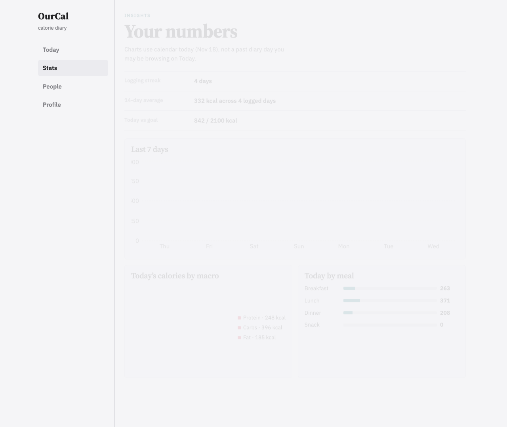

# OurCal

Local-first calorie and macro diary for the browser, with optional Supabase sync for friends and chat.

**Live:** [https://ourcal-pi.vercel.app](https://ourcal-pi.vercel.app)

[](https://github.com/5781mahmood/OurCal/actions/workflows/e2e.yml)

Screenshots use a fictional profile seeded in the browser (`scripts/capture-screenshots.mjs`). They are not a real account.





## Features

- Onboarding estimates a daily calorie target (Mifflin–St Jeor) and protein, carb, and fat goals
- Diary for Breakfast, Lunch, Dinner, and Snack, with search, custom foods, and a servings stepper
- Calorie ring, balance index, and macro levels (Low, On track, High, Over)
- Streak and badges
- Stats for the last 7 days, today vs goal, and today by meal, including empty states
- Friends via username, invite link (`/app?u=`), or QR, plus direct and small group chat
- Profile editing, photo, JSON export and import
- Diary stays in `localStorage` when cloud keys are absent

## Tech stack

- React 19, TypeScript, Vite
- React Router
- Supabase (optional Postgres + Realtime)
- Recharts
- qrcode.react and html5-qrcode
- Vitest and Playwright
- Vercel (deploys from `main`)

## Testing

Vitest covers nutrition, balance index, macro levels, streak, and badges. Playwright drives Chromium against the Vite app (`playwright.config.ts` starts the dev server).

| Area | What the specs check |
|------|----------------|
| Onboarding | Calorie goal appears; name required; Start tracking opens Today; Protein / Carbs / Fat labels |
| Diary | Logging updates the ring; delete clears it; servings stepper; day navigation and Jump to today; clear-day confirm and cancel; empty search; custom food |
| Routing | Landing call to action; custom 404; invite `?u=` opens People |
| People | QR and copy invite (`/app?u=`); no group with zero friends; cannot add yourself; chat Send stays disabled until there is text |
| Stats / Profile | Empty week copy; chart after a log; macro columns; Cancel edit; JSON download |
| Persistence | Reload keeps the diary; export, wipe, and import restores meals |
| Macros / balance | Level words; protein line after chicken; meal kcal header |
| Accessibility smoke | Nav by role; Escape closes the add-food dialog; ring `aria-label` |
| Edge cases | Short username; invalid friend input; Log food disabled until a food is selected; next day; reset |

```bash
npm test
npm run test:e2e
```

Latest local run: Vitest **12 passed** (5 files). Playwright **40 passed**.

Headed and UI modes: `npm run test:e2e:headed`, `npm run test:e2e:ui`.

GitHub Actions (`.github/workflows/e2e.yml`) runs the unit tests and Playwright on every push and pull request to `main`.

## Architecture

| Path | Purpose |
|------|---------|
| `src/types.ts` | Domain models |
| `src/lib/nutrition.ts` | BMR, TDEE, macro goals |
| `src/lib/balanceIndex.ts` | Balance score |
| `src/lib/macroLevel.ts` | Macro level, including over goal |
| `src/lib/streak.ts` | Logging streak |
| `src/lib/badges.ts` | Achievements |
| `src/lib/cloud.ts` | Supabase client and sync |
| `src/lib/storage.ts` | localStorage, export, import |
| `src/lib/invite.ts` | Invite URL `/app?u=` |
| `src/hooks/useTracker.ts` | App state |
| `src/components/*` | Today, Stats, People, Profile, onboarding |
| `src/pages/*` | Landing and 404 |
| `src/data/` | Bundled food catalog |
| `e2e/` | Playwright specs and helpers |
| `supabase/*.sql` | Postgres tables, RLS, realtime |
| `scripts/capture-screenshots.mjs` | Demo screenshots for this README |

## Run locally

```bash
npm install
npm run dev
```

`npm install` runs `postinstall`, which downloads Chromium for Playwright (`npx playwright install chromium`).

```bash
npm run build
```

## Supabase (optional)

1. Create a project at [supabase.com](https://supabase.com).
2. In the SQL editor, run `supabase/schema.sql`, then `supabase/social.sql`.
3. Copy the project URL and the anon public key (not `service_role`).
4. On Vercel, set these as Config variables, then redeploy. Vite reads them at build time:
   - `VITE_SUPABASE_URL`
   - `VITE_SUPABASE_ANON_KEY`

Without those keys the diary still works on one device. Placeholder values `0` and `1` are ignored.

## Known limits

Supabase row-level security in this repo is demo-open so more than one browser can share foods, friends, and chat in a class setting. A production deployment needs Supabase Auth and per-user policies. There is no USDA bulk import and no dedicated avatar storage bucket.
